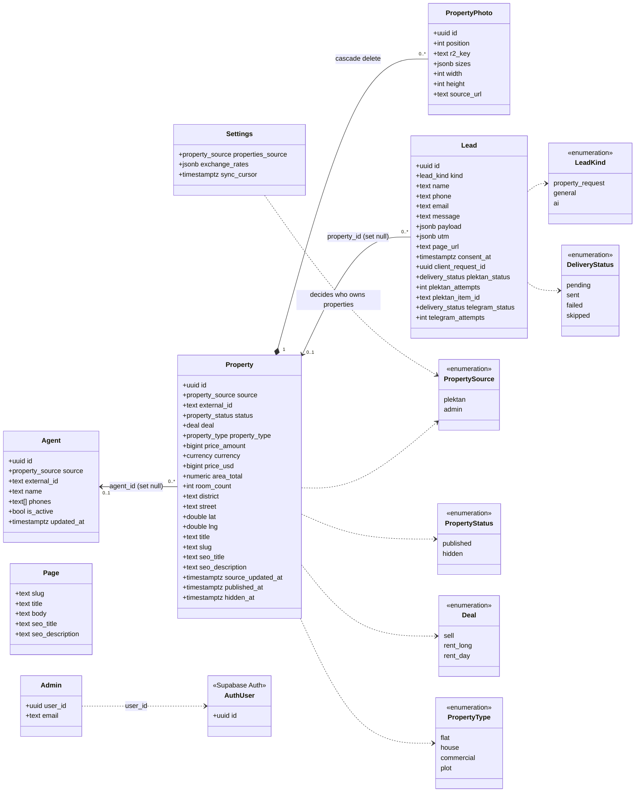
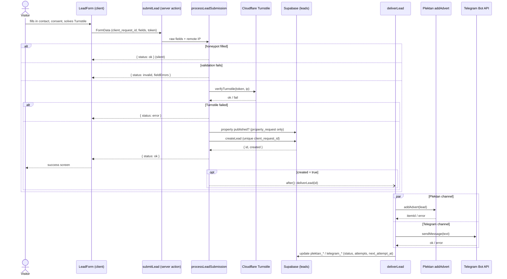
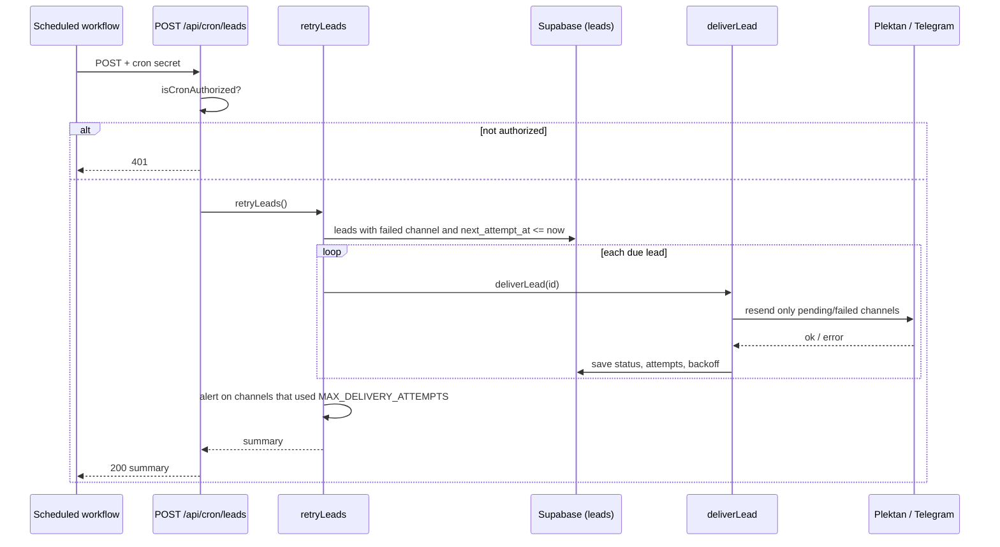
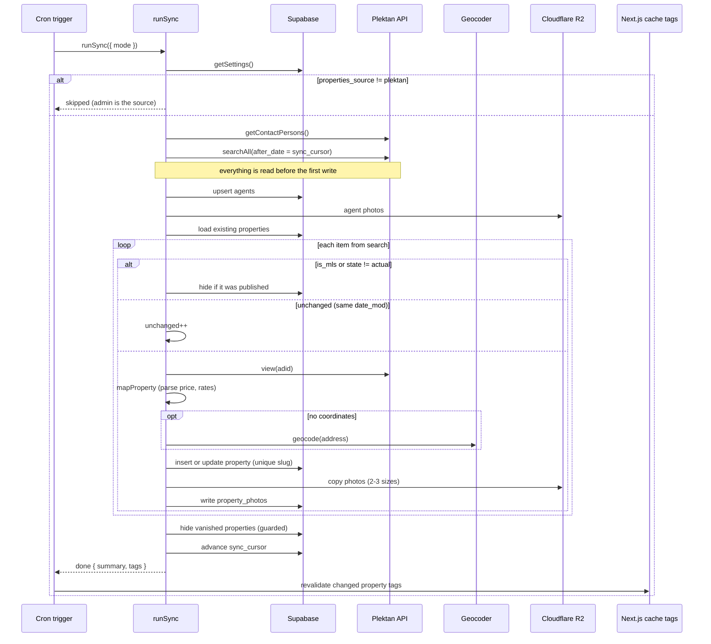
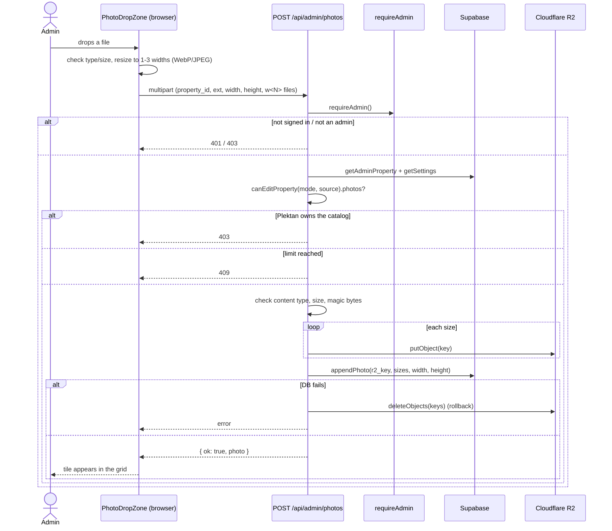
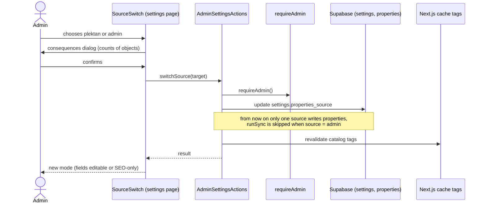

# UML diagrams

Class and sequence diagrams of Sofiacity, in [Mermaid](https://mermaid.js.org/) (rendered by GitHub and the VS Code Markdown preview). They describe the code as of spec 008. Product context: [product.md](product.md).

## Class diagram

### 1. Domain model (Supabase tables)

### 2. Application layers (`src/`)

```mermaid
classDiagram
    direction TB

    namespace app {
        class SitePages {
            <<Next.js routes>>
            / /catalog /catalog/slug /favorites
        }
        class AdminPages {
            <<Next.js routes>>
            /admin/leads /admin/properties /admin/settings
        }
        class CronRoutes {
            <<route handlers>>
            POST /api/cron/leads
            POST /api/cron/revalidate
        }
        class PhotosRoute {
            <<route handler>>
            POST /api/admin/photos
        }
    }

    namespace features {
        class LeadActions {
            <<server action>>
            +submitLead(prev, formData) LeadFormState
        }
        class SubmitLead {
            +processLeadSubmission(raw, ctx) LeadFormState
        }
        class DeliverLead {
            +deliverLead(id) DeliveryResult
            +retryLeadChannel(id, channel)
            +deliverLeadWith(deps, id)
        }
        class RetryLeads {
            +retryLeads()
        }
        class AdminPropertyActions {
            <<server actions>>
            +saveProperty()
            +reorderPhotos()
            +deletePhoto()
        }
        class AdminSettingsActions {
            <<server actions>>
            +switchSource()
            +saveRates()
        }
    }

    namespace lib_db {
        class LeadsRepo {
            +createLead(input)
            +getLeadForDelivery(id)
            +updateLeadDelivery(id, update)
        }
        class PropertiesRepo {
            <<public, RLS: published only>>
        }
        class AdminPropertiesRepo {
            +getAdminProperty(id)
            +appendPhoto(id, photo)
        }
        class SettingsRepo {
            +getSettings()
        }
        class PropertyPermissions {
            +canCreateProperty(mode) bool
            +canEditProperty(mode, source) PropertyPermissions
        }
    }

    namespace lib_integrations {
        class PlektanClient {
            +searchAll()
            +view(adid)
            +getContactPersons()
            +addAdvert(params)
        }
        class TelegramClient {
            +sendTelegramMessage(text)
        }
        class TurnstileVerifier {
            +verifyTurnstile(token, ip) bool
        }
        class GeocodeClient {
            +geocode(address)
        }
        class R2Client {
            +putObject(key, body, type)
            +deleteObjects(keys)
        }
        class SupabaseClients {
            +createAdminClient()
            +createServerClient()
            +createPublicClient()
        }
        class AdminSession {
            +getAdminSession()
            +requireAdmin()
        }
    }

    namespace lib_sync {
        class RunSync {
            +runSync(options) SyncResult
        }
        class SyncPhotos {
            +syncPropertyPhotos()
            +syncAgentPhotos()
        }
        class MapProperty {
            +mapProperty(item, card, rates)
        }
    }

    class FixtureMode {
        <<pattern>>
        every external client runs
        on fixtures without keys
    }

    SitePages --> PropertiesRepo
    SitePages --> LeadActions
    AdminPages --> AdminPropertiesRepo
    AdminPages --> AdminPropertyActions
    AdminPages --> AdminSettingsActions
    AdminPages --> AdminSession

    LeadActions --> SubmitLead
    SubmitLead --> TurnstileVerifier
    SubmitLead --> LeadsRepo
    SubmitLead --> DeliverLead : after()
    DeliverLead --> LeadsRepo
    DeliverLead --> PlektanClient
    DeliverLead --> TelegramClient
    RetryLeads --> DeliverLead
    CronRoutes --> RetryLeads
    CronRoutes --> RunSync

    AdminPropertyActions --> PropertyPermissions
    AdminPropertyActions --> AdminPropertiesRepo
    PhotosRoute --> AdminSession
    PhotosRoute --> PropertyPermissions
    PhotosRoute --> R2Client
    PhotosRoute --> AdminPropertiesRepo

    RunSync --> SettingsRepo
    RunSync --> PlektanClient
    RunSync --> MapProperty
    RunSync --> GeocodeClient
    RunSync --> SyncPhotos
    SyncPhotos --> R2Client

    LeadsRepo --> SupabaseClients
    PropertiesRepo --> SupabaseClients
    AdminPropertiesRepo --> SupabaseClients
    SettingsRepo --> SupabaseClients
    AdminSession --> SupabaseClients

    PlektanClient ..> FixtureMode
    TelegramClient ..> FixtureMode
    GeocodeClient ..> FixtureMode
```

## Sequence diagrams

### 1. Visitor submits a lead

The lead is saved **first**; Plektan and Telegram run after the response and never lose it.

### 2. Cron retries failed deliveries

### 3. Plektan sync (CRM mode)

### 4. Admin uploads a property photo

### 5. Admin switches the properties source

