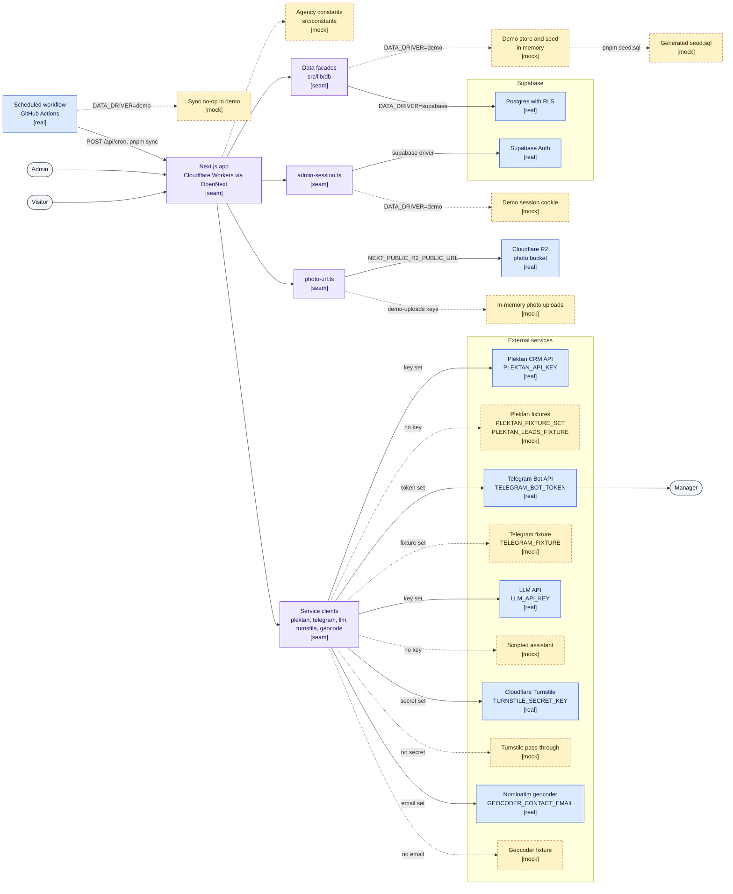
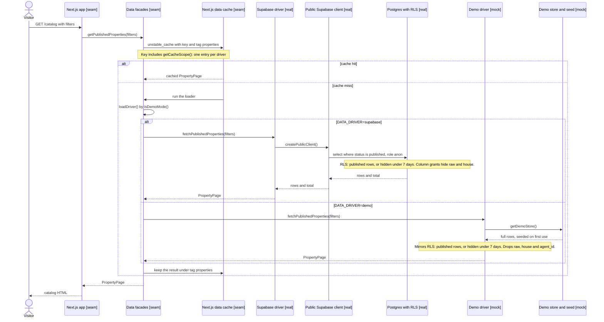

# UML diagrams

Diagrams of how the **7 SKY** real estate project is built around Supabase and Plektan, and where the mock data lives. They are written in [Mermaid](https://mermaid.js.org/) (GitHub and the VS Code Markdown preview render it) and describe the code **as of spec 015**. Product context: [product.md](product.md).

This file is the single source. `docs/diagrams.html` is generated from it: a self-contained viewer (no network, opens by double-click) where hovering or focusing any block shows a small tooltip with its marker and a short description. Elsewhere, for example on GitHub, the same text is in the «Blocks» table under each diagram.

## Legend

Every block carries one marker, written as text in its label (never by colour alone) and in the «Data» column of its table.

| Marker | Meaning |
| --- | --- |
| `real` | The production path: Supabase Postgres with RLS, Supabase Auth, R2, the live Plektan, Telegram, LLM, Turnstile and geocoder calls. Wired in code, **not connected to any account yet**. |
| `mock` | Exists only for demo or fixture mode: the in-memory store, the typed seed, the demo session cookie, in-memory photo uploads, service fixtures, the agency constants and the generated `supabase/seed.sql`. |
| `seam` | Code that serves both worlds and picks one by env: the `src/lib/db/*` facades, each service client's entry, `admin-session.ts` and `photo-url.ts`. |

A dash in the «Data» column means the block holds no data (a person or a trigger). In the diagrams a `mock` block has a dashed border and a dotted arrow leads to it.

## Blocks tables

Under every diagram there is a table with one row per block:

| Column | Content |
| --- | --- |
| `Block` | The key that matches the block in the Mermaid source: the node id in a flowchart, the class name in a class diagram, the participant or actor alias in a sequence diagram, the state id in a state diagram. |
| `Data` | `real`, `mock`, `seam` or a dash. |
| `What it is` | One plain sentence of at most 140 characters. It is the tooltip text. |
| `Code` | The path in the repo and the env variable that switches the block, if any. Shown in the table only. |

`pnpm diagrams` fails when a block has no row, when a row matches no block, or when a sentence is longer than 140 characters.

## Regenerating the viewer

```sh
pnpm diagrams
```

The generator reads this file, renders each diagram with Mermaid in the Playwright Chromium (offline, nothing is downloaded), checks the tables against the diagrams and writes `docs/diagrams.html`, which is committed. Edit this file, run the command, commit both files.

## 1. System context

Who uses the system, what it is made of, and, next to every `real` block, its `mock` twin; the env variable that picks each side is on the arrow or in the block. With no env at all the app runs on the mock side: that is the demo.



| Block | Data | What it is | Code |
| --- | --- | --- | --- |
| `visitor` | — | A person browsing the catalog, using the favourites, the lead forms and the AI assistant. | `src/app/(site)` |
| `manager` | — | An agency manager who receives a Telegram message for every new lead. | — |
| `admin` | — | An agency admin who manages properties, photos, leads, pages, posts and settings. | `src/app/admin` |
| `app` | seam | The one Next.js app on Cloudflare Workers that serves the site, the admin and the API, and picks each backend by env. | `src/app`, `wrangler.jsonc` |
| `consts` | mock | The demo agency's name, contacts, texts and navigation, kept as constants until a real agency's data replaces them. | `src/constants/*` |
| `facade` | seam | The only data entry point for pages and actions: it adds caching and picks the Supabase or the demo driver. | `src/lib/db/*`, `DATA_DRIVER` in `src/lib/data-driver.ts` |
| `pg` | real | Supabase Postgres with row-level security: the production store of properties, photos, leads, pages, posts and AI chats. | `src/lib/db/supabase/*`, `supabase/migrations/` |
| `auth` | real | Supabase Auth with email and password; an admin is a user listed in the admins table. | `src/lib/supabase/{server,client,admin}.ts` |
| `store` | mock | The typed seed loaded into memory per process, with the same read and write rules that RLS applies in Postgres. | `src/lib/demo/store.ts`, `src/lib/demo/seed/*`, `src/lib/demo/db/*` |
| `seedsql` | mock | The SQL file generated from the demo seed so a local Supabase can start with the same listings. | `supabase/seed.sql`, `pnpm seed:sql` |
| `adminsession` | seam | Answers who is calling the admin: a Supabase Auth user checked against admins, or the signed demo cookie. | `src/lib/auth/admin-session.ts` |
| `session` | mock | A signed httpOnly cookie behind the one-click demo sign-in, with no account or network call. | `src/lib/demo/session.ts`, `DEMO_SESSION_SECRET` |
| `photourl` | seam | Turns a stored photo key into a URL: R2, an in-memory demo upload, or a local placeholder file. | `src/lib/photos/photo-url.ts`, `NEXT_PUBLIC_R2_PUBLIC_URL` |
| `r2` | real | Cloudflare R2 holds property, agent and post photos in two or three sizes; the Worker binding or the S3 API writes them. | `src/lib/r2/client.ts`, `R2_*`, `PHOTOS_BUCKET` |
| `photos` | mock | Photos uploaded in the demo admin, kept in memory and served by a demo route; the limit is set by an env variable. | `src/lib/demo/photos.ts`, `DEMO_UPLOAD_MAX_MB` |
| `clients` | seam | One small client per external service; each picks the live API or its fixture from env on every call. | `src/lib/{plektan,telegram,llm,turnstile,geocode}/` |
| `plektan` | real | The Plektan CRM API: the source of synced properties and agents, and the target of the leads that we send back. | `src/lib/plektan/client.ts`, `PLEKTAN_API_KEY` |
| `plektanfx` | mock | Canned Plektan answers and canned lead results, so sync and lead delivery run locally without a key. | `src/lib/plektan/fixtures/*`, `PLEKTAN_FIXTURE_SET`, `PLEKTAN_LEADS_FIXTURE` |
| `telegram` | real | The Telegram bot that sends each new lead to the managers' chat. | `src/lib/telegram/client.ts`, `TELEGRAM_BOT_TOKEN`, `TELEGRAM_MANAGER_CHAT_ID` |
| `telegramfx` | mock | A fixture that logs the message instead of sending it, or fails on purpose to test the retry. | `src/lib/telegram/client.ts`, `TELEGRAM_FIXTURE` |
| `llm` | real | The OpenAI chat API that powers the property assistant. | `src/lib/llm/client.ts`, `LLM_API_KEY`, `LLM_MODEL` |
| `llmfx` | mock | A scripted assistant that answers without any model, used when there is no API key. | `src/lib/llm/fixtures/*` |
| `turnstile` | real | Cloudflare Turnstile checks that a lead form was filled in by a person. | `src/lib/turnstile/verify.ts`, `TURNSTILE_SECRET_KEY` |
| `turnstilefx` | mock | With an empty secret every token passes, so forms work locally without the widget keys. | `src/lib/turnstile/verify.ts` |
| `geocoder` | real | The Nominatim geocoder that finds coordinates for synced properties that arrive without them. | `src/lib/geocode/client.ts`, `GEOCODER_CONTACT_EMAIL` |
| `geocoderfx` | mock | A fixture that returns fixed coordinates for known addresses and never touches the network. | `src/lib/geocode/fixture.ts` |
| `cron` | real | A scheduled GitHub Actions workflow that runs the Plektan sync and calls the lead retry and cleanup routes. | `.github/workflows/sync.yml`, `CRON_SECRET`, `src/app/api/cron/*` |
| `cronnoop` | mock | In demo mode the sync script prints a notice and exits, because the store already holds the seed listings. | `scripts/sync.ts`, `DATA_DRIVER=demo` |

## 2. Mock-data map

Every place where mock data lives, what reads it, and the one arrow that turns the typed seed into SQL. All of it is `mock`; the blocks around it show who picks it. With no env at all everything on this page is what the app runs on.


| Block | Data | What it is | Code |
| --- | --- | --- | --- |
| `app` | seam | The one Next.js app on Cloudflare Workers that serves the site, the admin and the API, and picks each backend by env. | `src/app`, `wrangler.jsonc` |
| `facade` | seam | The only data entry point for pages and actions: it adds caching and picks the Supabase or the demo driver. | `src/lib/db/*`, `DATA_DRIVER` in `src/lib/data-driver.ts` |
| `adminsession` | seam | Answers who is calling the admin: a Supabase Auth user checked against admins, or the signed demo cookie. | `src/lib/auth/admin-session.ts` |
| `photourl` | seam | Turns a stored photo key into a URL: R2, an in-memory demo upload, or a local placeholder file. | `src/lib/photos/photo-url.ts`, `NEXT_PUBLIC_R2_PUBLIC_URL` |
| `clients` | seam | One small client per external service; each picks the live API or its fixture from env on every call. | `src/lib/{plektan,telegram,llm,turnstile,geocode}/` |
| `sync` | seam | The Plektan import: reads listings through the Plektan client, writes properties and photos, and stops at once in demo mode. | `src/lib/sync/run-sync.ts`, `scripts/sync.ts` |
| `consts` | mock | The demo agency's name, contacts, texts and navigation, kept as constants until a real agency's data replaces them. | `src/constants/*` |
| `seed` | mock | The typed demo listings, agents, pages, posts and leads, written as TypeScript rows that match the generated database types. | `src/lib/demo/seed/*` |
| `seedsql` | mock | The SQL file generated from the demo seed so a local Supabase can start with the same listings. | `supabase/seed.sql`, `pnpm seed:sql` |
| `placeholders` | mock | Stock photos that the seed's photo keys point to, committed so the demo shows pictures without any storage. | `public/placeholders/*` |
| `demodrivers` | mock | One demo driver per data domain: it reads and writes the in-memory store and applies the RLS rules in code. | `src/lib/demo/db/*`, `DATA_DRIVER=demo` |
| `store` | mock | The typed seed loaded into memory per process, with the same read and write rules that RLS applies in Postgres. | `src/lib/demo/store.ts`, `src/lib/demo/seed/*`, `src/lib/demo/db/*` |
| `session` | mock | A signed httpOnly cookie behind the one-click demo sign-in, with no account or network call. | `src/lib/demo/session.ts`, `DEMO_SESSION_SECRET` |
| `photos` | mock | Photos uploaded in the demo admin, kept in memory and served by a demo route; the limit is set by an env variable. | `src/lib/demo/photos.ts`, `DEMO_UPLOAD_MAX_MB` |
| `r2local` | mock | Files the R2 client writes to a local folder when there is no bucket binding or key, so sync and uploads work offline. | `src/lib/r2/client.ts`, `public/r2-local` |
| `plektanfx` | mock | Canned Plektan answers and canned lead results, so sync and lead delivery run locally without a key. | `src/lib/plektan/fixtures/*`, `PLEKTAN_FIXTURE_SET`, `PLEKTAN_LEADS_FIXTURE` |
| `telegramfx` | mock | A fixture that logs the message instead of sending it, or fails on purpose to test the retry. | `src/lib/telegram/client.ts`, `TELEGRAM_FIXTURE` |
| `llmfx` | mock | A scripted assistant that answers without any model, used when there is no API key. | `src/lib/llm/fixtures/*` |
| `turnstilefx` | mock | With an empty secret every token passes, so forms work locally without the widget keys. | `src/lib/turnstile/verify.ts` |
| `geocoderfx` | mock | A fixture that returns fixed coordinates for known addresses and never touches the network. | `src/lib/geocode/fixture.ts` |
| `localdb` | real | A Postgres and Auth stack started with Docker, the only database a developer can use without any account. | `supabase/config.toml`, `supabase/migrations/` |

## 3. Data-driver seam

How one call reaches either world. Pages, actions and route handlers import only the facade; the facade asks `data-driver.ts` which driver is on and loads that driver on demand. The two drivers implement one contract and never import each other. Next to the data seam are the two other seams: who is the admin, and where a photo comes from. The four Supabase clients are listed with what each one is for.

```mermaid
classDiagram
    direction TB

    class Callers["Callers"]:::person {
        pages and layouts
        server actions
        route handlers
    }
    class DataDriver["data-driver.ts [seam]"]:::seam {
        +getDataDriver() demo or supabase
        +isDemoMode() boolean
        +getCacheScope() string
    }
    class Facade["Data facades [seam]"]:::seam {
        +getPublishedProperties() PropertyPage
        -loadDriver() PropertiesDriver
        unstable_cache and cache tags
    }
    class Contract["Driver contract [seam]"]:::seam {
        <<interface>>
        +fetchPublishedProperties()
        +fetchPropertyBySlug()
    }
    class SupabaseDriver["Supabase driver [real]"]:::real {
        src/lib/db/supabase
    }
    class DemoDriver["Demo driver [mock]"]:::mock {
        src/lib/demo/db
    }
    class DemoStore["Demo store and seed [mock]"]:::mock {
        +getDemoStore() DemoData
        +resetDemoStore() DemoData
    }
    class DemoSeed["Typed demo seed [mock]"]:::mock {
        +buildDemoSeed(now) DemoData
    }
    class PublicClient["Public Supabase client [real]"]:::real {
        anon key, no cookies
    }
    class ServerClient["Server Supabase client [real]"]:::real {
        anon key, user session cookies
    }
    class BrowserClient["Browser Supabase client [real]"]:::real {
        anon key, in the browser
    }
    class AdminClient["Admin Supabase client [real]"]:::real {
        service role, bypasses RLS
    }
    class Postgres["Postgres with RLS [real]"]:::real
    class AdminSession["admin-session.ts [seam]"]:::seam {
        +getAdminSession() AdminSession
        +requireAdmin() result
    }
    class SupabaseAuth["Supabase Auth [real]"]:::real
    class DemoSession["Demo session cookie [mock]"]:::mock {
        +signDemoSession()
        +verifyDemoSession()
    }
    class PhotoUrl["photo-url.ts [seam]"]:::seam {
        +photoUrl(key) string
    }
    class R2["Cloudflare R2 [real]"]:::real
    class DemoPhotos["In-memory photo uploads [mock]"]:::mock {
        served by /api/demo/photos
    }

    Callers --> Facade : imports only this
    Facade ..> DataDriver : asks which driver
    Facade ..> Contract : returns
    SupabaseDriver ..|> Contract
    DemoDriver ..|> Contract
    Facade ..> SupabaseDriver : loads when supabase
    Facade ..> DemoDriver : loads when demo
    SupabaseDriver --> PublicClient : public reads
    SupabaseDriver --> ServerClient : admin reads
    SupabaseDriver --> AdminClient : writes
    PublicClient --> Postgres
    ServerClient --> Postgres
    AdminClient --> Postgres
    DemoDriver --> DemoStore
    DemoStore --> DemoSeed : built from

    Callers --> AdminSession
    AdminSession ..> DataDriver
    AdminSession --> ServerClient : supabase driver
    ServerClient --> SupabaseAuth
    BrowserClient --> SupabaseAuth
    AdminSession --> DemoSession : demo driver

    Callers --> PhotoUrl
    PhotoUrl --> R2 : base URL set
    PhotoUrl --> DemoPhotos : demo-uploads keys

    note for Facade "Callers never see a driver. A test keeps both drivers on one contract."
    note for DemoDriver "SupabaseDriver and DemoDriver never import each other."
    note for BrowserClient "No file imports this client today."

    classDef real fill:#dbeafe,stroke:#1d4ed8,color:#0b1f4d
    classDef mock fill:#fef3c7,stroke:#b45309,color:#3b2300,stroke-dasharray:5 4
    classDef seam fill:#ede9fe,stroke:#6d28d9,color:#2a1065
    classDef person fill:#f3f4f6,stroke:#4b5563,color:#111827

```



| Block | Data | What it is | Code |
| --- | --- | --- | --- |
| `Callers` | — | Pages, layouts, server actions and route handlers; they import the facade and never a driver. | `src/app`, `src/features` |
| `DataDriver` | seam | Reads DATA_DRIVER and says whether the app runs on Supabase or on the demo store; empty means Supabase if its env is set. | `src/lib/data-driver.ts`, `DATA_DRIVER` |
| `Facade` | seam | The only data entry point for pages and actions: it adds caching and picks the Supabase or the demo driver. | `src/lib/db/*`, `DATA_DRIVER` in `src/lib/data-driver.ts` |
| `Contract` | seam | The TypeScript interfaces that both drivers implement, so the two worlds return the same shapes. | `src/lib/db/driver-types.ts`, `src/lib/db/driver-contract.test.ts` |
| `SupabaseDriver` | real | The driver that runs the queries on Supabase Postgres; row-level security decides what each caller sees. | `src/lib/db/supabase/*`, `DATA_DRIVER=supabase` |
| `DemoDriver` | mock | One demo driver per data domain: it reads and writes the in-memory store and applies the RLS rules in code. | `src/lib/demo/db/*`, `DATA_DRIVER=demo` |
| `DemoStore` | mock | The typed seed loaded into memory per process, with the same read and write rules that RLS applies in Postgres. | `src/lib/demo/store.ts`, `src/lib/demo/seed/*`, `src/lib/demo/db/*` |
| `DemoSeed` | mock | The function that builds every demo row from the typed seed; the same rows are rendered to supabase seed.sql. | `src/lib/demo/seed/index.ts`, `pnpm seed:sql` |
| `PublicClient` | real | A cookie-less Supabase client with the anon key for public reads, so pages can be cached; RLS limits it to public rows. | `src/lib/supabase/public.ts` |
| `ServerClient` | real | A Supabase client with the anon key that carries the visitor's session cookies; used for sign-in and admin reads. | `src/lib/supabase/server.ts` |
| `BrowserClient` | real | A Supabase client with the anon key for use in the browser; nothing in the code imports it yet. | `src/lib/supabase/client.ts` |
| `AdminClient` | real | A Supabase client with the service role key that bypasses RLS; server code only, for sync, leads and admin writes. | `src/lib/supabase/admin.ts`, `SUPABASE_SERVICE_ROLE_KEY` |
| `Postgres` | real | Supabase Postgres with row-level security: the production store of properties, photos, leads, pages, posts and AI chats. | `src/lib/db/supabase/*`, `supabase/migrations/` |
| `AdminSession` | seam | Answers who is calling the admin: a Supabase Auth user checked against admins, or the signed demo cookie. | `src/lib/auth/admin-session.ts` |
| `SupabaseAuth` | real | Supabase Auth with email and password; an admin is a user listed in the admins table. | `src/lib/supabase/{server,client,admin}.ts` |
| `DemoSession` | mock | A signed httpOnly cookie behind the one-click demo sign-in, with no account or network call. | `src/lib/demo/session.ts`, `DEMO_SESSION_SECRET` |
| `PhotoUrl` | seam | Turns a stored photo key into a URL: R2, an in-memory demo upload, or a local placeholder file. | `src/lib/photos/photo-url.ts`, `NEXT_PUBLIC_R2_PUBLIC_URL` |
| `R2` | real | Cloudflare R2 holds property, agent and post photos in two or three sizes; the Worker binding or the S3 API writes them. | `src/lib/r2/client.ts`, `R2_*`, `PHOTOS_BUCKET` |
| `DemoPhotos` | mock | Photos uploaded in the demo admin, kept in memory and served by a demo route; the limit is set by an env variable. | `src/lib/demo/photos.ts`, `DEMO_UPLOAD_MAX_MB` |

## 4. Domain model

All 12 tables of `supabase/migrations/` and the 7 enums they use, with key columns only: ids, foreign keys, status and enum columns, delivery columns and the Plektan-owned columns. Every table is `real`: it lives in Supabase Postgres. In demo mode the same row types, taken from `src/lib/supabase/database.types.ts`, live in the in-memory store, and the demo drivers apply the RLS rule written in the note of each table.

How to read it: `PK` primary key, `FK` foreign key, `PLEKTAN` a column owned by the Plektan integration: synced data that the admin does not edit while the properties source is `plektan`, or the state of sending a lead to Plektan. Three more columns hold a value from a fixed list that is a `check` constraint, not an enum: `posts.category`, `posts.status` and `ai_messages.role`. `admins.user_id` points to `auth.users` of Supabase Auth, which is not a public table. Three kinds of RLS rule appear in the notes: public read, admin only (an admin reads through `is_admin()`), and service role only (no policy, no grant).


| Block | Data | What it is | Code |
| --- | --- | --- | --- |
| `property_source` | real | The enum that says who owns a record: the Plektan sync or the admin; used by agents, properties and the settings switch. | `supabase/migrations/20261028120000_properties.sql` |
| `property_status` | real | The enum for the public state of a property: published, or hidden (draft, sold or vanished from Plektan). | `supabase/migrations/20261028120000_properties.sql` |
| `deal` | real | The enum for the kind of deal: sale, long-term rent or daily rent. | `supabase/migrations/20261028120000_properties.sql` |
| `property_type` | real | The enum for the kind of property: flat, house, commercial or plot. | `supabase/migrations/20261028120000_properties.sql` |
| `currency` | real | The enum for the currency of a price: UAH, USD or EUR. | `supabase/migrations/20261028120000_properties.sql` |
| `lead_kind` | real | The enum for where a lead came from: a property request, the general form or the AI assistant. | `supabase/migrations/20261028130000_leads_pages_settings.sql` |
| `delivery_status` | real | The enum for the state of sending a lead to Plektan or Telegram: pending, sent, failed or skipped. | `supabase/migrations/20261028130000_leads_pages_settings.sql` |
| `agents` | real | The people shown as contacts on a property; Plektan agents are synced, others are added in the admin. | `supabase/migrations/20261028120000_properties.sql` |
| `properties` | real | The listings: one row per property with its price, area, address, status and, for Plektan ones, the raw payload. | `supabase/migrations/20261028120000_properties.sql`, `20261028150000_property_hidden_at.sql` |
| `property_photos` | real | The ordered photos of a property, each pointing to an R2 key with its sizes. | `supabase/migrations/20261028120000_properties.sql` |
| `leads` | real | Every request a visitor sends, saved before any delivery, with the delivery state and retry data for Plektan and Telegram. | `supabase/migrations/20261028130000_leads_pages_settings.sql`, `20261028160000_lead_retry.sql` |
| `pages` | real | Static pages such as the privacy policy, written in Markdown in the admin, with their SEO and draft flags. | `supabase/migrations/20261028130000_leads_pages_settings.sql` |
| `settings` | real | The single settings row: which source owns properties, the sync cursor and the exchange rates. | `supabase/migrations/20261028130000_leads_pages_settings.sql` |
| `admins` | real | The list of Supabase Auth users who are admins; the is_admin function reads it. | `supabase/migrations/20261028170000_admins.sql` |
| `ai_conversations` | real | One assistant chat with its page, property, lead, proposal, token counts and a salted hash of the visitor IP. | `supabase/migrations/20261029150000_ai_assistant.sql` |
| `ai_messages` | real | The transcript of an assistant chat: user, assistant and tool messages, deleted with the conversation. | `supabase/migrations/20261029150000_ai_assistant.sql`, `20261104120000_ai_limits.sql` |
| `ai_usage` | real | One row per month with the tokens and the cost spent on the assistant, used for the monthly spend cap. | `supabase/migrations/20261104120000_ai_limits.sql` |
| `posts` | real | Blog posts in Markdown with a category, tags, a cover, an author and a draft or published status. | `supabase/migrations/20261105120000_blog.sql` |
| `post_properties` | real | Up to three related properties per blog post, in order. | `supabase/migrations/20261105120000_blog.sql` |

## 5. Public read on each driver

A catalog request goes through the same facade and the same Next.js data cache; only the driver behind them differs. On Supabase the row-level security of Postgres limits an anonymous caller to public rows. On the demo driver there is no database, so the demo driver applies the same rule in code. A cache hit never reaches a driver. Admin writes expire the cache by tag, on both drivers.



| Block | Data | What it is | Code |
| --- | --- | --- | --- |
| `visitor` | — | A person browsing the catalog, using the favourites, the lead forms and the AI assistant. | `src/app/(site)` |
| `app` | seam | The one Next.js app on Cloudflare Workers that serves the site, the admin and the API, and picks each backend by env. | `src/app`, `wrangler.jsonc` |
| `facade` | seam | The only data entry point for pages and actions: it adds caching and picks the Supabase or the demo driver. | `src/lib/db/properties.ts`, `DATA_DRIVER` in `src/lib/data-driver.ts` |
| `cache` | seam | The Next.js data cache around every public read; its key includes the driver, and admin writes expire it by tag. | `unstable_cache` in `src/lib/db/*`, `src/lib/db/cache-tags.ts` |
| `sbdriver` | real | The driver that runs the queries on Supabase Postgres; row-level security decides what each caller sees. | `src/lib/db/supabase/properties.ts`, `DATA_DRIVER=supabase` |
| `publicclient` | real | A cookie-less Supabase client with the anon key for public reads, so pages can be cached; RLS limits it to public rows. | `src/lib/supabase/public.ts` |
| `pg` | real | Supabase Postgres with row-level security: the production store of properties, photos, leads, pages, posts and AI chats. | `src/lib/db/supabase/*`, `supabase/migrations/` |
| `demodriver` | mock | One demo driver per data domain: it reads and writes the in-memory store and applies the RLS rules in code. | `src/lib/demo/db/properties.ts`, `DATA_DRIVER=demo` |
| `store` | mock | The typed seed loaded into memory per process, with the same read and write rules that RLS applies in Postgres. | `src/lib/demo/store.ts`, `src/lib/demo/seed/*`, `src/lib/demo/db/*` |
