# UML diagrams

Diagrams of how the **7 SKY** real estate project is built around Supabase and Plektan, and where the mock data lives. They are written in [Mermaid](https://mermaid.js.org/) (GitHub and the VS Code Markdown preview render it) and describe the code **as of spec 015**. Product context: [product.md](product.md).

This file is the single source. `docs/diagrams.html` is generated from it: a self-contained viewer (no network, opens by double-click) where hovering or focusing any block shows a small tooltip with its marker and a short description. Elsewhere, for example on GitHub, the same text is in the «Blocks» table under each diagram.

## Legend

Every block carries one marker, written as text in its label (never by colour alone) and in the «Data» column of its table.

| Marker | Meaning |
| --- | --- |
| `real` | The production path: Supabase Postgres with RLS, Supabase Auth, R2, the live Plektan, Telegram, LLM, Turnstile and geocoder calls. Wired in code, **not connected to any account yet**. |
| `mock` | Exists only for demo or fixture mode: the in-memory store, the typed seed, the demo session cookie, in-memory photo uploads, service fixtures, the agency constants and the generated `supabase/seed.sql`. |
| `seam` | Code that serves both worlds and picks one by env: the `src/lib/db/*` facades, each service client's entry, `admin-session.ts` and `photo-url.ts`. |

A dash in the «Data» column means the block holds no data (a person or a trigger). In the diagrams a `mock` block has a dashed border and a dotted arrow leads to it.

## Blocks tables

Under every diagram there is a table with one row per block:

| Column | Content |
| --- | --- |
| `Block` | The key that matches the block in the Mermaid source: the node id in a flowchart, the class name in a class diagram, the participant or actor alias in a sequence diagram, the state id in a state diagram. |
| `Data` | `real`, `mock`, `seam` or a dash. |
| `What it is` | One plain sentence of at most 140 characters. It is the tooltip text. |
| `Code` | The path in the repo and the env variable that switches the block, if any. Shown in the table only. |

`pnpm diagrams` fails when a block has no row, when a row matches no block, or when a sentence is longer than 140 characters.

## Regenerating the viewer

```sh
pnpm diagrams
```

The generator reads this file, renders each diagram with Mermaid in the Playwright Chromium (offline, nothing is downloaded), checks the tables against the diagrams and writes `docs/diagrams.html`, which is committed. Edit this file, run the command, commit both files.

## 1. System context

Who uses the system, what it is made of, and, next to every `real` block, its `mock` twin; the env variable that picks each side is on the arrow or in the block. With no env at all the app runs on the mock side: that is the demo.


| Block | Data | What it is | Code |
| --- | --- | --- | --- |
| `visitor` | — | A person browsing the catalog, using the favourites, the lead forms and the AI assistant. | `src/app/(site)` |
| `manager` | — | An agency manager who receives a Telegram message for every new lead. | — |
| `admin` | — | An agency admin who manages properties, photos, leads, pages, posts and settings. | `src/app/admin` |
| `app` | seam | The one Next.js app on Cloudflare Workers that serves the site, the admin and the API, and picks each backend by env. | `src/app`, `wrangler.jsonc` |
| `consts` | mock | The demo agency's name, contacts, texts and navigation, kept as constants until a real agency's data replaces them. | `src/constants/*` |
| `facade` | seam | The only data entry point for pages and actions: it adds caching and picks the Supabase or the demo driver. | `src/lib/db/*`, `DATA_DRIVER` in `src/lib/data-driver.ts` |
| `pg` | real | Supabase Postgres with row-level security: the production store of properties, photos, leads, pages, posts and AI chats. | `src/lib/db/supabase/*`, `supabase/migrations/` |
| `auth` | real | Supabase Auth with email and password; an admin is a user listed in the admins table. | `src/lib/supabase/{server,admin}.ts` |
| `store` | mock | The in-memory store that holds the typed seed for each process, with the same read and write rules that RLS applies in Postgres. | `src/lib/demo/store.ts`, `src/lib/demo/seed/*`, `src/lib/demo/db/*` |
| `seedsql` | mock | The SQL file generated from the demo seed so a local Supabase can start with the same listings. | `supabase/seed.sql`, `pnpm seed:sql` |
| `adminsession` | seam | Answers who is calling the admin: a Supabase Auth user checked against admins, or the signed demo cookie. | `src/lib/auth/admin-session.ts` |
| `session` | mock | A signed httpOnly cookie behind the one-click demo sign-in, with no account or network call. | `src/lib/demo/session.ts`, `DEMO_SESSION_SECRET` |
| `photourl` | seam | Turns a stored photo key into a URL: R2, an in-memory demo upload, or a local placeholder file. | `src/lib/photos/photo-url.ts`, `NEXT_PUBLIC_R2_PUBLIC_URL` |
| `r2` | real | Cloudflare R2 holds property, agent and post photos in two or three sizes; the Worker binding or the S3 API writes them. | `src/lib/r2/client.ts`, `R2_*`, `PHOTOS_BUCKET` |
| `photos` | mock | Photos uploaded in the demo admin, kept in memory and served by a demo route; the limit is set by an env variable. | `src/lib/demo/photos.ts`, `DEMO_UPLOAD_MAX_MB` |
| `clients` | seam | One small client per external service; each picks the live API or its fixture from env on every call. | `src/lib/{plektan,telegram,llm,turnstile,geocode}/` |
| `plektan` | real | The Plektan CRM API: the source of synced properties and agents, and the target of the leads that we send back. | `src/lib/plektan/client.ts`, `PLEKTAN_API_KEY` |
| `plektanfx` | mock | Canned Plektan answers and canned lead results, so sync and lead delivery run locally without a key. | `src/lib/plektan/fixtures/*`, `PLEKTAN_FIXTURE_SET`, `PLEKTAN_LEADS_FIXTURE` |
| `telegram` | real | The Telegram bot that sends each new lead to the managers' chat. | `src/lib/telegram/client.ts`, `TELEGRAM_BOT_TOKEN`, `TELEGRAM_MANAGER_CHAT_ID` |
| `telegramfx` | mock | A fixture that logs the message instead of sending it, or fails on purpose to test the retry. | `src/lib/telegram/client.ts`, `TELEGRAM_FIXTURE` |
| `llm` | real | The OpenAI chat API that powers the property assistant. | `src/lib/llm/client.ts`, `LLM_API_KEY`, `LLM_MODEL` |
| `llmfx` | mock | A scripted assistant that answers without any model, used when there is no API key. | `src/lib/llm/fixtures/*` |
| `turnstile` | real | Cloudflare Turnstile checks that a lead form was filled in by a person. | `src/lib/turnstile/verify.ts`, `TURNSTILE_SECRET_KEY` |
| `turnstilefx` | mock | With an empty secret every token passes, so forms work locally without the widget keys. | `src/lib/turnstile/verify.ts` |
| `geocoder` | real | The Nominatim geocoder that finds coordinates for synced properties that arrive without them. | `src/lib/geocode/client.ts`, `GEOCODER_CONTACT_EMAIL` |
| `geocoderfx` | mock | A fixture that returns fixed coordinates for known addresses and never touches the network. | `src/lib/geocode/fixture.ts` |
| `cron` | real | A scheduled GitHub Actions workflow that runs the Plektan sync and calls the lead retry and cleanup routes. | `.github/workflows/sync.yml`, `CRON_SECRET`, `src/app/api/cron/*` |
| `cronnoop` | mock | In demo mode the sync script prints a notice and exits, because the store already holds the seed listings. | `scripts/sync.ts`, `DATA_DRIVER=demo` |

## 2. Mock-data map

Every place where mock data lives, what reads it, and the one arrow that turns the typed seed into SQL. All of it is `mock`; the blocks around it show who picks it. With no env at all everything on this page is what the app runs on.

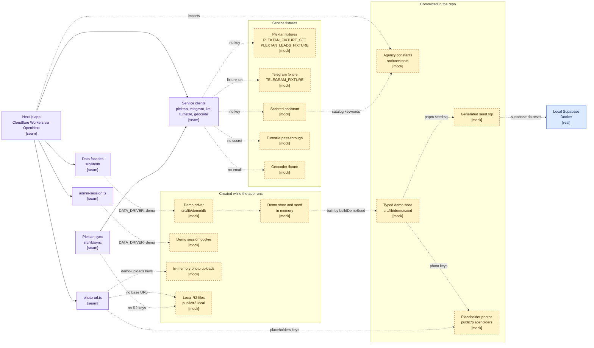

| Block | Data | What it is | Code |
| --- | --- | --- | --- |
| `app` | seam | The one Next.js app on Cloudflare Workers that serves the site, the admin and the API, and picks each backend by env. | `src/app`, `wrangler.jsonc` |
| `facade` | seam | The only data entry point for pages and actions: it adds caching and picks the Supabase or the demo driver. | `src/lib/db/*`, `DATA_DRIVER` in `src/lib/data-driver.ts` |
| `adminsession` | seam | Answers who is calling the admin: a Supabase Auth user checked against admins, or the signed demo cookie. | `src/lib/auth/admin-session.ts` |
| `photourl` | seam | Turns a stored photo key into a URL: R2, an in-memory demo upload, or a local placeholder file. | `src/lib/photos/photo-url.ts`, `NEXT_PUBLIC_R2_PUBLIC_URL` |
| `clients` | seam | One small client per external service; each picks the live API or its fixture from env on every call. | `src/lib/{plektan,telegram,llm,turnstile,geocode}/` |
| `sync` | seam | The Plektan import: reads listings through the Plektan client, writes properties and photos, and stops at once in demo mode. | `src/lib/sync/run-sync.ts`, `scripts/sync.ts` |
| `consts` | mock | The demo agency's name, contacts, texts and navigation, kept as constants until a real agency's data replaces them. | `src/constants/*` |
| `seed` | mock | Builds the typed demo rows (listings, agents, pages, posts and leads) that match the database types; also rendered to supabase seed.sql. | `src/lib/demo/seed/*` |
| `seedsql` | mock | The SQL file generated from the demo seed so a local Supabase can start with the same listings. | `supabase/seed.sql`, `pnpm seed:sql` |
| `placeholders` | mock | Stock photos that the seed's photo keys point to, committed so the demo shows pictures without any storage. | `public/placeholders/*` |
| `demodrivers` | mock | One demo driver per data domain: it reads and writes the in-memory store and applies the RLS rules in code. | `src/lib/demo/db/*`, `DATA_DRIVER=demo` |
| `store` | mock | The in-memory store that holds the typed seed for each process, with the same read and write rules that RLS applies in Postgres. | `src/lib/demo/store.ts`, `src/lib/demo/seed/*`, `src/lib/demo/db/*` |
| `session` | mock | A signed httpOnly cookie behind the one-click demo sign-in, with no account or network call. | `src/lib/demo/session.ts`, `DEMO_SESSION_SECRET` |
| `photos` | mock | Photos uploaded in the demo admin, kept in memory and served by a demo route; the limit is set by an env variable. | `src/lib/demo/photos.ts`, `DEMO_UPLOAD_MAX_MB` |
| `r2local` | mock | Files the R2 client writes to a local folder when there is no bucket binding or key, so sync and uploads work offline. | `src/lib/r2/client.ts`, `public/r2-local` |
| `plektanfx` | mock | Canned Plektan answers and canned lead results, so sync and lead delivery run locally without a key. | `src/lib/plektan/fixtures/*`, `PLEKTAN_FIXTURE_SET`, `PLEKTAN_LEADS_FIXTURE` |
| `telegramfx` | mock | A fixture that logs the message instead of sending it, or fails on purpose to test the retry. | `src/lib/telegram/client.ts`, `TELEGRAM_FIXTURE` |
| `llmfx` | mock | A scripted assistant that answers without any model, used when there is no API key. | `src/lib/llm/fixtures/*` |
| `turnstilefx` | mock | With an empty secret every token passes, so forms work locally without the widget keys. | `src/lib/turnstile/verify.ts` |
| `geocoderfx` | mock | A fixture that returns fixed coordinates for known addresses and never touches the network. | `src/lib/geocode/fixture.ts` |
| `localdb` | real | A Postgres and Auth stack started with Docker, the only database a developer can use without any account. | `supabase/config.toml`, `supabase/migrations/` |

## 3. Data-driver seam

How one call reaches either world. Pages, actions and route handlers import only the facade; the facade asks `data-driver.ts` which driver is on and loads that driver on demand. The two drivers implement one contract and never import each other. Next to the data seam are the two other seams: who is the admin, and where a photo comes from. The three Supabase clients are listed with what each one is for.

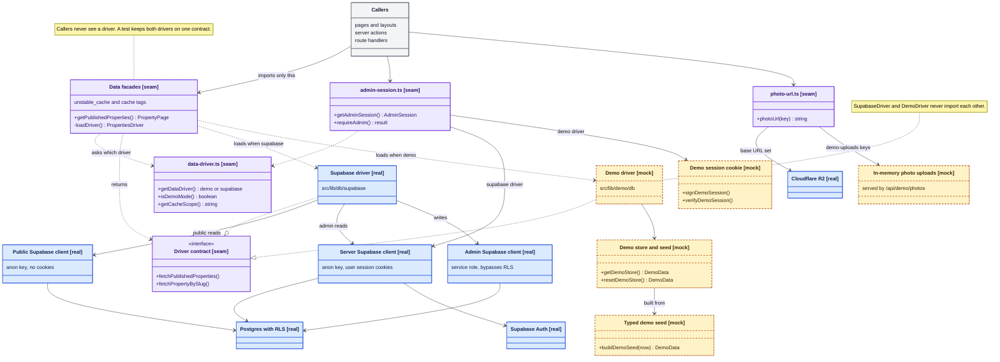

| Block | Data | What it is | Code |
| --- | --- | --- | --- |
| `Callers` | — | Pages, layouts, server actions and route handlers; they import the facade and never a driver. | `src/app`, `src/features` |
| `DataDriver` | seam | Reads DATA_DRIVER and says whether the app runs on Supabase or on the demo store; empty means Supabase if its env is set. | `src/lib/data-driver.ts`, `DATA_DRIVER` |
| `Facade` | seam | The only data entry point for pages and actions: it adds caching and picks the Supabase or the demo driver. | `src/lib/db/*`, `DATA_DRIVER` in `src/lib/data-driver.ts` |
| `Contract` | seam | The TypeScript interfaces that both drivers implement, so the two worlds return the same shapes. | `src/lib/db/driver-types.ts`, `src/lib/db/driver-contract.test.ts` |
| `SupabaseDriver` | real | The driver that runs the queries on Supabase Postgres; row-level security decides what each caller sees. | `src/lib/db/supabase/*`, `DATA_DRIVER=supabase` |
| `DemoDriver` | mock | One demo driver per data domain: it reads and writes the in-memory store and applies the RLS rules in code. | `src/lib/demo/db/*`, `DATA_DRIVER=demo` |
| `DemoStore` | mock | The in-memory store that holds the typed seed for each process, with the same read and write rules that RLS applies in Postgres. | `src/lib/demo/store.ts`, `src/lib/demo/seed/*`, `src/lib/demo/db/*` |
| `DemoSeed` | mock | Builds the typed demo rows (listings, agents, pages, posts and leads) that match the database types; also rendered to supabase seed.sql. | `src/lib/demo/seed/index.ts`, `pnpm seed:sql` |
| `PublicClient` | real | A cookie-less Supabase client with the anon key for public reads, so pages can be cached; RLS limits it to public rows. | `src/lib/supabase/public.ts` |
| `ServerClient` | real | A Supabase client with the anon key that carries the visitor's session cookies; used for sign-in and admin reads. | `src/lib/supabase/server.ts` |
| `AdminClient` | real | A Supabase client with the service role key that bypasses RLS; server code only, for sync, leads and admin writes. | `src/lib/supabase/admin.ts`, `SUPABASE_SERVICE_ROLE_KEY` |
| `Postgres` | real | Supabase Postgres with row-level security: the production store of properties, photos, leads, pages, posts and AI chats. | `src/lib/db/supabase/*`, `supabase/migrations/` |
| `AdminSession` | seam | Answers who is calling the admin: a Supabase Auth user checked against admins, or the signed demo cookie. | `src/lib/auth/admin-session.ts` |
| `SupabaseAuth` | real | Supabase Auth with email and password; an admin is a user listed in the admins table. | `src/lib/supabase/{server,admin}.ts` |
| `DemoSession` | mock | A signed httpOnly cookie behind the one-click demo sign-in, with no account or network call. | `src/lib/demo/session.ts`, `DEMO_SESSION_SECRET` |
| `PhotoUrl` | seam | Turns a stored photo key into a URL: R2, an in-memory demo upload, or a local placeholder file. | `src/lib/photos/photo-url.ts`, `NEXT_PUBLIC_R2_PUBLIC_URL` |
| `R2` | real | Cloudflare R2 holds property, agent and post photos in two or three sizes; the Worker binding or the S3 API writes them. | `src/lib/r2/client.ts`, `R2_*`, `PHOTOS_BUCKET` |
| `DemoPhotos` | mock | Photos uploaded in the demo admin, kept in memory and served by a demo route; the limit is set by an env variable. | `src/lib/demo/photos.ts`, `DEMO_UPLOAD_MAX_MB` |

## 4. Domain model

All 12 tables of `supabase/migrations/` and the 7 enums they use, with key columns only: ids, foreign keys, status and enum columns, delivery columns and the Plektan-owned columns. Every table is `real`: it lives in Supabase Postgres. In demo mode the same row types, taken from `src/lib/supabase/database.types.ts`, live in the in-memory store, and the demo drivers apply the RLS rule written in the note of each table.

How to read it: `PK` primary key, `FK` foreign key, `PLEKTAN` a column owned by the Plektan integration: synced data that the admin does not edit while the properties source is `plektan`, or the state of sending a lead to Plektan. Three more columns hold a value from a fixed list that is a `check` constraint, not an enum: `posts.category`, `posts.status` and `ai_messages.role`. `admins.user_id` points to `auth.users` of Supabase Auth, which is not a public table. Three kinds of RLS rule appear in the notes: public read, admin only (an admin reads through `is_admin()`), and service role only (no policy, no grant).

```mermaid
classDiagram
    direction TB

    class property_source["property_source [real]"]:::real {
        <<enumeration>>
        plektan
        admin
    }
    class property_status["property_status [real]"]:::real {
        <<enumeration>>
        published
        hidden
    }
    class deal["deal [real]"]:::real {
        <<enumeration>>
        sell
        rent_long
        rent_day
    }
    class property_type["property_type [real]"]:::real {
        <<enumeration>>
        flat
        house
        commercial
        plot
    }
    class currency["currency [real]"]:::real {
        <<enumeration>>
        UAH
        USD
        EUR
    }
    class lead_kind["lead_kind [real]"]:::real {
        <<enumeration>>
        property_request
        general
        ai
    }
    class delivery_status["delivery_status [real]"]:::real {
        <<enumeration>>
        pending
        sent
        failed
        skipped
    }

    class agents["agents [real]"]:::real {
        +uuid id PK
        +property_source source PLEKTAN
        +text external_id PLEKTAN
        +text name
        +boolean is_active
    }
    class properties["properties [real]"]:::real {
        +uuid id PK
        +property_source source PLEKTAN
        +text external_id PLEKTAN
        +property_status status
        +deal deal
        +property_type property_type
        +currency currency
        +bigint price_amount
        +bigint price_usd
        +text slug
        +uuid agent_id FK
        +jsonb raw PLEKTAN
        +timestamptz source_updated_at PLEKTAN
        +timestamptz synced_at
        +timestamptz published_at
        +timestamptz hidden_at
    }
    class property_photos["property_photos [real]"]:::real {
        +uuid id PK
        +uuid property_id FK
        +int position
        +text r2_key
    }
    class leads["leads [real]"]:::real {
        +uuid id PK
        +lead_kind kind
        +uuid property_id FK
        +uuid client_request_id
        +delivery_status plektan_status PLEKTAN
        +int plektan_attempts PLEKTAN
        +text plektan_item_id PLEKTAN
        +timestamptz plektan_next_attempt_at PLEKTAN
        +delivery_status telegram_status
        +int telegram_attempts
        +timestamptz telegram_next_attempt_at
    }
    class pages["pages [real]"]:::real {
        +text slug PK
        +text title
        +boolean is_draft
        +boolean noindex
    }
    class settings["settings [real]"]:::real {
        +boolean id PK
        +property_source properties_source PLEKTAN
        +text sync_cursor PLEKTAN
        +timestamptz last_sync_at
        +jsonb exchange_rates
    }
    class admins["admins [real]"]:::real {
        +uuid user_id PK
        +text email
    }
    class ai_conversations["ai_conversations [real]"]:::real {
        +uuid id PK
        +uuid property_id FK
        +uuid lead_id FK
        +jsonb proposal
        +int message_count
        +numeric cost_usd
        +text ip_hash
    }
    class ai_messages["ai_messages [real]"]:::real {
        +uuid id PK
        +uuid conversation_id FK
        +text role
        +uuid client_message_id
    }
    class ai_usage["ai_usage [real]"]:::real {
        +date month PK
        +bigint input_tokens
        +bigint output_tokens
        +numeric cost_usd
    }
    class posts["posts [real]"]:::real {
        +uuid id PK
        +text slug
        +text category
        +text status
        +uuid author_agent_id FK
        +timestamptz published_at
    }
    class post_properties["post_properties [real]"]:::real {
        +uuid post_id PK
        +uuid property_id PK
        +smallint position
    }

    agents "1" --> "0..*" properties : agent_id
    properties "1" --> "0..*" property_photos : property_id
    properties "0..1" <-- "0..*" leads : property_id
    properties "0..1" <-- "0..*" ai_conversations : property_id
    leads "0..1" <-- "0..1" ai_conversations : lead_id
    ai_conversations "1" --> "0..*" ai_messages : conversation_id
    agents "0..1" <-- "0..*" posts : author_agent_id
    posts "1" --> "0..*" post_properties : post_id
    properties "1" --> "0..*" post_properties : property_id

    property_source <.. agents
    property_source <.. properties
    property_source <.. settings
    property_status <.. properties
    deal <.. properties
    property_type <.. properties
    currency <.. properties
    lead_kind <.. leads
    delivery_status <.. leads

    note for agents "RLS: public read of active agents. Writes: service role."
    note for properties "RLS: public read of published rows and of rows hidden under 7 days ago, without raw and house columns. Admins read all."
    note for property_photos "RLS: public read for photos of visible properties. Admins read all."
    note for leads "RLS: admin only. An admin reads, the public sees nothing. Writes: service role."
    note for pages "RLS: public read of every page. Writes: service role."
    note for settings "RLS: service role only. No policy and no grant."
    note for admins "RLS: an admin reads only their own row. Writes: service role or SQL."
    note for ai_conversations "RLS: service role only. No policy and no grant."
    note for ai_messages "RLS: service role only. No policy and no grant."
    note for ai_usage "RLS: service role only. No policy and no grant."
    note for posts "RLS: public read of published posts. Writes: service role."
    note for post_properties "RLS: public read of links of published posts. Writes: service role."

    classDef real fill:#dbeafe,stroke:#1d4ed8,color:#0b1f4d
```

| Block | Data | What it is | Code |
| --- | --- | --- | --- |
| `property_source` | real | The enum that says who owns a record: the Plektan sync or the admin; used by agents, properties and the settings switch. | `supabase/migrations/20261028120000_properties.sql` |
| `property_status` | real | The enum for the public state of a property: published, or hidden (draft, sold or vanished from Plektan). | `supabase/migrations/20261028120000_properties.sql` |
| `deal` | real | The enum for the kind of deal: sale, long-term rent or daily rent. | `supabase/migrations/20261028120000_properties.sql` |
| `property_type` | real | The enum for the kind of property: flat, house, commercial or plot. | `supabase/migrations/20261028120000_properties.sql` |
| `currency` | real | The enum for the currency of a price: UAH, USD or EUR. | `supabase/migrations/20261028120000_properties.sql` |
| `lead_kind` | real | The enum for where a lead came from: a property request, the general form or the AI assistant. | `supabase/migrations/20261028130000_leads_pages_settings.sql` |
| `delivery_status` | real | The enum for the state of sending a lead to Plektan or Telegram: pending, sent, failed or skipped. | `supabase/migrations/20261028130000_leads_pages_settings.sql` |
| `agents` | real | The people shown as contacts on a property; Plektan agents are synced, others are added in the admin. | `supabase/migrations/20261028120000_properties.sql` |
| `properties` | real | The listings: one row per property with its price, area, address, status and, for Plektan ones, the raw payload. | `supabase/migrations/20261028120000_properties.sql`, `20261028150000_property_hidden_at.sql` |
| `property_photos` | real | The ordered photos of a property, each pointing to an R2 key with its sizes. | `supabase/migrations/20261028120000_properties.sql` |
| `leads` | real | Every request a visitor sends, saved before any delivery, with the delivery state and retry data for Plektan and Telegram. | `supabase/migrations/20261028130000_leads_pages_settings.sql`, `20261028160000_lead_retry.sql` |
| `pages` | real | Static pages such as the privacy policy, written in Markdown in the admin, with their SEO and draft flags. | `supabase/migrations/20261028130000_leads_pages_settings.sql` |
| `settings` | real | The single settings row: which source owns properties, the sync cursor and the exchange rates. | `supabase/migrations/20261028130000_leads_pages_settings.sql` |
| `admins` | real | The list of Supabase Auth users who are admins; the is_admin function reads it. | `supabase/migrations/20261028170000_admins.sql` |
| `ai_conversations` | real | One assistant chat with its page, property, lead, proposal, token counts and a salted hash of the visitor IP. | `supabase/migrations/20261029150000_ai_assistant.sql` |
| `ai_messages` | real | The transcript of an assistant chat: user, assistant and tool messages, deleted with the conversation. | `supabase/migrations/20261029150000_ai_assistant.sql`, `20261104120000_ai_limits.sql` |
| `ai_usage` | real | One row per month with the tokens and the cost spent on the assistant, used for the monthly spend cap. | `supabase/migrations/20261104120000_ai_limits.sql` |
| `posts` | real | Blog posts in Markdown with a category, tags, a cover, an author and a draft or published status. | `supabase/migrations/20261105120000_blog.sql` |
| `post_properties` | real | Up to three related properties per blog post, in order. | `supabase/migrations/20261105120000_blog.sql` |

## 5. Public read on each driver

A catalog request goes through the same facade and the same Next.js data cache; only the driver behind them differs. On Supabase the row-level security of Postgres limits an anonymous caller to public rows. On the demo driver there is no database, so the demo driver applies the same rule in code. A cache hit never reaches a driver. Admin writes expire the cache by tag, on both drivers.

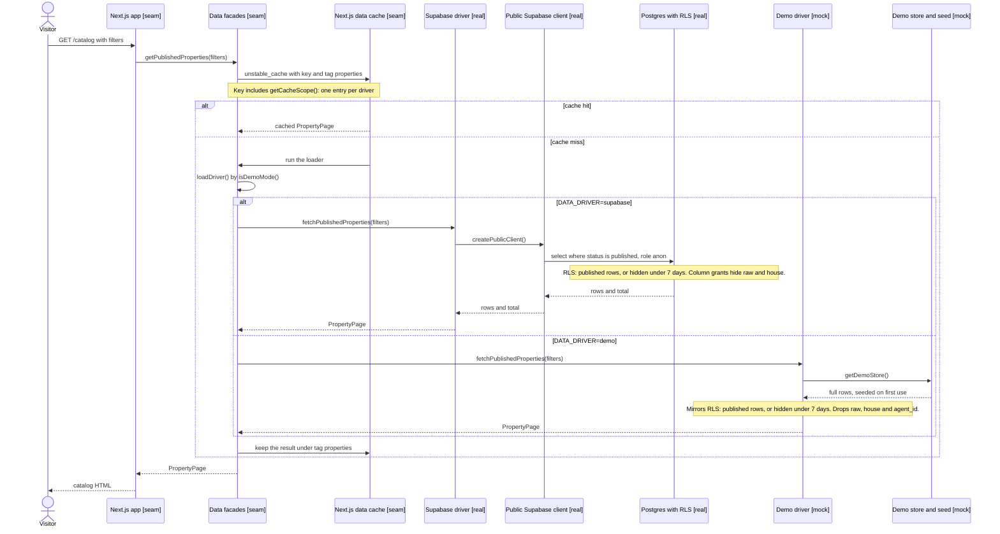

| Block | Data | What it is | Code |
| --- | --- | --- | --- |
| `visitor` | — | A person browsing the catalog, using the favourites, the lead forms and the AI assistant. | `src/app/(site)` |
| `app` | seam | The one Next.js app on Cloudflare Workers that serves the site, the admin and the API, and picks each backend by env. | `src/app`, `wrangler.jsonc` |
| `facade` | seam | The only data entry point for pages and actions: it adds caching and picks the Supabase or the demo driver. | `src/lib/db/properties.ts`, `DATA_DRIVER` in `src/lib/data-driver.ts` |
| `cache` | seam | The Next.js data cache around every public read; its key includes the driver, and admin writes expire it by tag. | `unstable_cache` in `src/lib/db/*`, `src/lib/db/cache-tags.ts` |
| `sbdriver` | real | The driver that runs the queries on Supabase Postgres; row-level security decides what each caller sees. | `src/lib/db/supabase/properties.ts`, `DATA_DRIVER=supabase` |
| `publicclient` | real | A cookie-less Supabase client with the anon key for public reads, so pages can be cached; RLS limits it to public rows. | `src/lib/supabase/public.ts` |
| `pg` | real | Supabase Postgres with row-level security: the production store of properties, photos, leads, pages, posts and AI chats. | `src/lib/db/supabase/*`, `supabase/migrations/` |
| `demodriver` | mock | One demo driver per data domain: it reads and writes the in-memory store and applies the RLS rules in code. | `src/lib/demo/db/properties.ts`, `DATA_DRIVER=demo` |
| `store` | mock | The in-memory store that holds the typed seed for each process, with the same read and write rules that RLS applies in Postgres. | `src/lib/demo/store.ts`, `src/lib/demo/seed/*`, `src/lib/demo/db/*` |

## 6. Plektan API and our model

The six methods that `src/lib/plektan/index.ts` exports, next to the live API and its fixture twin, and the tables that each one feeds or reads. `search` and `view` feed `properties` and their photos, `getContactPersons` feeds `agents`, and `addAdvert` is the only call that sends data out: it carries a lead, and its result goes back into the `plektan_` columns of `leads`. The sync also reads and writes `settings` for the source switch and the cursor. Lead delivery to Plektan has three modes: `off`, `live` and fixture.

```mermaid
classDiagram
    direction TB

    class Sync["Plektan sync [seam]"]:::seam {
        +runSync(options) SyncResult
    }
    class DeliverLead["Lead delivery [seam]"]:::seam {
        +deliverLead(id) DeliveryResult
    }
    class Client["Plektan client [seam]"]:::seam {
        +search(params) PlektanSearchPage
        +searchAll(params) PlektanSearchPage
        +view(params) PlektanViewItem
        +getContactPersons() PlektanContactPerson[]
        +getDistricts(params) PlektanDistrict[]
        +addAdvert(params) PlektanAddAdvertResult
        +resolvePlektanLeadsMode() PlektanLeadsMode
        +createPlektanClient(config) PlektanClient
    }
    class LeadsMode["Plektan leads mode [seam]"]:::seam {
        <<enumeration>>
        off
        live
        fixture ok
        fixture fail
    }
    class PlektanApi["Plektan CRM API [real]"]:::real {
        POST API_serp/search
        POST API_view/view
        POST API_user/getContactPersons
        POST API_geo/getDistricts
        POST API_view/addAdvert
    }
    class Fixtures["Plektan fixtures [mock]"]:::mock {
        +fixtureResponse(set, section, command) raw JSON
        +addAdvertFixtureResponse(mode) ADDED or error
        sets base and next
    }
    class properties["properties [real]"]:::real
    class property_photos["property_photos [real]"]:::real
    class agents["agents [real]"]:::real
    class leads["leads [real]"]:::real
    class settings["settings [real]"]:::real
    class R2["Cloudflare R2 [real]"]:::real

    Sync ..> Client : searchAll, view, getContactPersons
    DeliverLead ..> LeadsMode : asks the mode first
    DeliverLead ..> Client : addAdvert
    Client --> PlektanApi : key set
    Client ..> Fixtures : no key
    LeadsMode --> PlektanApi : live
    LeadsMode ..> Fixtures : fixture flag

    Sync --> properties : rows from search and view
    Sync --> agents : rows from getContactPersons
    Sync --> property_photos : photos from view media
    property_photos --> R2 : copied as WebP
    Sync --> settings : reads source, writes cursor
    DeliverLead --> leads : result into plektan columns

    note for Client "Env is read on every call. Without PLEKTAN_API_KEY every method answers from the fixtures except addAdvert. getDistricts has no caller in the app yet."
    note for PlektanApi "POST form to re.plektan.com with header x-auth-token and version 1.1. 15 s timeout, 2 retries on network and 5xx errors, never for addAdvert."
    note for LeadsMode "PLEKTAN_LEADS_FIXTURE wins, then PLEKTAN_API_KEY means live, otherwise off: the lead is marked skipped and Plektan is not called."
    note for Fixtures "The transport answers search, view, getContactPersons and getDistricts. addAdvert has its own flag and, with neither flag nor key, throws."

    classDef real fill:#dbeafe,stroke:#1d4ed8,color:#0b1f4d
    classDef mock fill:#fef3c7,stroke:#b45309,color:#3b2300,stroke-dasharray:5 4
    classDef seam fill:#ede9fe,stroke:#6d28d9,color:#2a1065
```

| Block | Data | What it is | Code |
| --- | --- | --- | --- |
| `Sync` | seam | The Plektan import: reads listings through the Plektan client, writes properties and photos, and stops at once in demo mode. | `src/lib/sync/run-sync.ts`, `scripts/sync.ts` |
| `DeliverLead` | seam | Sends a saved lead to Plektan and Telegram, each channel on its own, and writes the result back on the lead. | `src/features/leads/deliver-lead.ts` |
| `Client` | seam | The Plektan client: six methods that call the live API with a key and the fixtures without one, deciding from env on every call. | `src/lib/plektan/index.ts`, `src/lib/plektan/client.ts`, `PLEKTAN_API_KEY`, `PLEKTAN_LANG` |
| `LeadsMode` | seam | How lead delivery to Plektan runs now: a fixture flag wins, then a key means live, and with neither the channel is skipped. | `src/lib/plektan/client.ts`, `PLEKTAN_LEADS_FIXTURE`, `PLEKTAN_API_KEY` |
| `PlektanApi` | real | The Plektan CRM API: the source of synced properties and agents, and the target of the leads that we send back. | `src/lib/plektan/client.ts`, `PLEKTAN_API_KEY` |
| `Fixtures` | mock | Canned Plektan answers and canned lead results, so sync and lead delivery run locally without a key. | `src/lib/plektan/fixtures/*`, `PLEKTAN_FIXTURE_SET`, `PLEKTAN_LEADS_FIXTURE` |
| `properties` | real | The listings: one row per property with its price, area, address, status and, for Plektan ones, the raw payload. | `supabase/migrations/20261028120000_properties.sql`, `20261028150000_property_hidden_at.sql` |
| `property_photos` | real | The ordered photos of a property, each pointing to an R2 key with its sizes. | `supabase/migrations/20261028120000_properties.sql` |
| `agents` | real | The people shown as contacts on a property; Plektan agents are synced, others are added in the admin. | `supabase/migrations/20261028120000_properties.sql` |
| `leads` | real | Every request a visitor sends, saved before any delivery, with the delivery state and retry data for Plektan and Telegram. | `supabase/migrations/20261028130000_leads_pages_settings.sql`, `20261028160000_lead_retry.sql` |
| `settings` | real | The single settings row: which source owns properties, the sync cursor and the exchange rates. | `supabase/migrations/20261028130000_leads_pages_settings.sql` |
| `R2` | real | Cloudflare R2 holds property, agent and post photos in two or three sizes; the Worker binding or the S3 API writes them. | `src/lib/r2/client.ts`, `R2_*`, `PHOTOS_BUCKET` |

## 7. Plektan sync

One run of `runSync` (`src/lib/sync/run-sync.ts`), started by the scheduled workflow: an incremental run every 30 minutes by day and a full one at night. It runs only on the Supabase driver: it writes with the service-role client, not through the facades. In demo mode `pnpm sync` prints a notice and exits, because the store already holds the seed's `plektan`-sourced listings. Everything is read from Plektan before the first property is written, so a failing search leaves the data untouched. With an empty `PLEKTAN_API_KEY` the same code would run on the fixtures, but the workflow skips the job without the key, so fixtures are never synced into production.

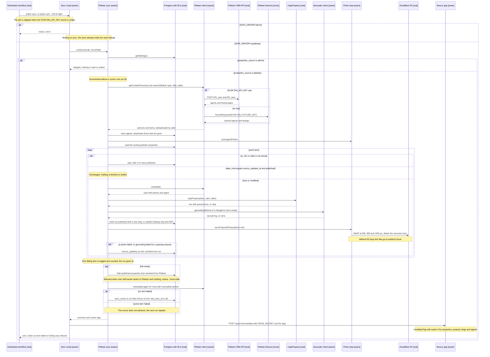

| Block | Data | What it is | Code |
| --- | --- | --- | --- |
| `cron` | real | A scheduled GitHub Actions workflow that runs the Plektan sync and calls the lead retry and cleanup routes. | `.github/workflows/sync.yml`, `CRON_SECRET`, `src/app/api/cron/*` |
| `script` | seam | The pnpm sync command: it stops with a notice in demo mode, otherwise runs the sync and asks the site to expire the changed cache tags. | `scripts/sync.ts`, `DATA_DRIVER`, `NEXT_PUBLIC_SITE_URL`, `CRON_SECRET` |
| `runsync` | seam | The Plektan import: reads listings through the Plektan client, writes properties and photos, and stops at once in demo mode. | `src/lib/sync/run-sync.ts`, `scripts/sync.ts` |
| `pg` | real | Supabase Postgres with row-level security: the production store of properties, photos, leads, pages, posts and AI chats. | `src/lib/db/supabase/*`, `supabase/migrations/` |
| `client` | seam | The Plektan client: six methods that call the live API with a key and the fixtures without one, deciding from env on every call. | `src/lib/plektan/index.ts`, `src/lib/plektan/client.ts`, `PLEKTAN_API_KEY`, `PLEKTAN_LANG` |
| `plektan` | real | The Plektan CRM API: the source of synced properties and agents, and the target of the leads that we send back. | `src/lib/plektan/client.ts`, `PLEKTAN_API_KEY` |
| `plektanfx` | mock | Canned Plektan answers and canned lead results, so sync and lead delivery run locally without a key. | `src/lib/plektan/fixtures/*`, `PLEKTAN_FIXTURE_SET`, `PLEKTAN_LEADS_FIXTURE` |
| `mapper` | real | A pure function that turns a Plektan item and card into a properties row, parsing the price text and skipping partner or inactive items. | `src/lib/sync/map-property.ts`, `src/lib/sync/parse-price.ts` |
| `geo` | seam | Finds coordinates for an address with Nominatim, or from fixed fixture answers when the contact email is empty. | `src/lib/geocode/client.ts`, `GEOCODER_CONTACT_EMAIL` |
| `photos` | seam | The sync photo step: downloads each photo, makes WebP copies at three widths and writes them to R2 or to local files. | `src/lib/sync/sync-photos.ts`, `R2_*` |
| `r2` | real | Cloudflare R2 holds property, agent and post photos in two or three sizes; the Worker binding or the S3 API writes them. | `src/lib/r2/client.ts`, `R2_*`, `PHOTOS_BUCKET` |
| `site` | seam | The one Next.js app on Cloudflare Workers that serves the site, the admin and the API, and picks each backend by env. | `src/app`, `wrangler.jsonc` |

## 8. Lead delivery

A lead from the site form or from a confirmed AI assistant card. The order is fixed: checks, then the lead is saved, then the visitor gets the answer, and only after that Plektan and Telegram are called, in the background, each channel on its own. The save goes through the facade to Postgres or to the demo store. Each channel has its own mode: Plektan is `live` with a key, a fixture with `PLEKTAN_LEADS_FIXTURE`, or `off`; Telegram is `live` with a token and a chat id, a fixture with `TELEGRAM_FIXTURE`, or `off`. An `off` channel is marked `skipped` and nothing is called, so the site and the lead work with Plektan switched off. Later, when the channel is on, the cron requeues a recent `skipped` channel ([diagram 9](#9-lead-retry-cron)), and in the admin «Надіслати» sends it once by hand, at any age. A failed call is written on the lead with a retry time and is picked up by the cron of [diagram 9](#9-lead-retry-cron).

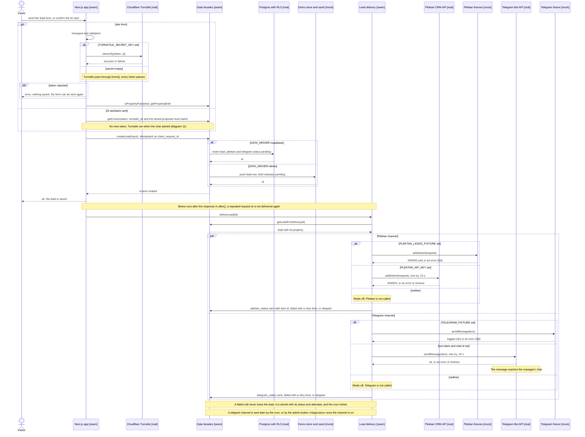

| Block | Data | What it is | Code |
| --- | --- | --- | --- |
| `visitor` | — | A person browsing the catalog, using the favourites, the lead forms and the AI assistant. | `src/app/(site)` |
| `app` | seam | The one Next.js app on Cloudflare Workers that serves the site, the admin and the API, and picks each backend by env. | `src/features/leads/submit-lead.ts`, `src/features/assistant/submit-assistant-lead.ts` |
| `turnstile` | real | Cloudflare Turnstile checks that a lead form was filled in by a person. | `src/lib/turnstile/verify.ts`, `TURNSTILE_SECRET_KEY` |
| `facade` | seam | The only data entry point for pages and actions: it adds caching and picks the Supabase or the demo driver. | `src/lib/db/leads.ts`, `DATA_DRIVER` in `src/lib/data-driver.ts` |
| `pg` | real | Supabase Postgres with row-level security: the production store of properties, photos, leads, pages, posts and AI chats. | `src/lib/db/supabase/leads.ts`, `supabase/migrations/` |
| `store` | mock | The in-memory store that holds the typed seed for each process, with the same read and write rules that RLS applies in Postgres. | `src/lib/demo/db/leads.ts`, `src/lib/demo/store.ts` |
| `deliver` | seam | Sends a saved lead to Plektan and Telegram, each channel on its own, and writes the result back on the lead. | `src/features/leads/deliver-lead.ts` |
| `plektan` | real | The Plektan CRM API: the source of synced properties and agents, and the target of the leads that we send back. | `src/lib/plektan/client.ts`, `PLEKTAN_API_KEY` |
| `plektanfx` | mock | Canned Plektan answers and canned lead results, so sync and lead delivery run locally without a key. | `src/lib/plektan/fixtures/leads.ts`, `PLEKTAN_LEADS_FIXTURE` |
| `telegram` | real | The Telegram bot that sends each new lead to the managers' chat. | `src/lib/telegram/client.ts`, `TELEGRAM_BOT_TOKEN`, `TELEGRAM_MANAGER_CHAT_ID` |
| `telegramfx` | mock | A fixture that logs the message instead of sending it, or fails on purpose to test the retry. | `src/lib/telegram/client.ts`, `TELEGRAM_FIXTURE` |

## 9. Lead retry cron

What picks up a lead whose Plektan or Telegram call failed, or whose background delivery was lost. The scheduled workflow calls the route every 30 minutes by day with the shared secret. A lead is due when a channel is `failed`, has attempts left (5 in total, waits of 5 minutes, 15 minutes, 1 hour and 3 hours) and its retry time has come, or when a channel is still `pending` 10 minutes after the lead was saved. `deliverLead` is the same code as in [diagram 8](#8-lead-delivery), so the two channels again run on their own and the mode of each decides what is called. Before that query the run moves a channel that is now on from `skipped` back to `pending`, for leads younger than 7 days (`SKIPPED_REQUEUE_DAYS`); the stale-pending rule then delivers them in the same run. A channel still off is never touched, and a `sent` channel never goes again. A lead that ran out of Plektan or Telegram attempts also sends one Telegram alert (one message even when both ran out), so the manager can call the visitor; each channel is alerted once. Nothing here needs Plektan: with Plektan off the channel is `skipped` and is not due until it is switched on. The leads stay in the admin whatever happens.

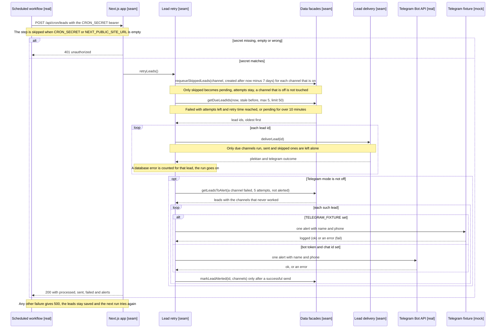

| Block | Data | What it is | Code |
| --- | --- | --- | --- |
| `cron` | real | A scheduled GitHub Actions workflow that runs the Plektan sync and calls the lead retry and cleanup routes. | `.github/workflows/sync.yml`, `CRON_SECRET`, `src/app/api/cron/*` |
| `app` | seam | The one Next.js app on Cloudflare Workers that serves the site, the admin and the API, and picks each backend by env. | `src/app/api/cron/leads/route.ts`, `src/lib/cron/check-cron-secret.ts` |
| `retry` | seam | One cron run: requeues skipped channels that are on, delivers due leads, then sends one alert per lead Plektan or Telegram never took. | `src/features/leads/retry-leads.ts`, `src/features/leads/retry-schedule.ts` |
| `facade` | seam | The only data entry point for pages and actions: it adds caching and picks the Supabase or the demo driver. | `src/lib/db/leads.ts`, `DATA_DRIVER` in `src/lib/data-driver.ts` |
| `deliver` | seam | Sends a saved lead to Plektan and Telegram, each channel on its own, and writes the result back on the lead. | `src/features/leads/deliver-lead.ts` |
| `telegram` | real | The Telegram bot that sends each new lead to the managers' chat. | `src/lib/telegram/client.ts`, `TELEGRAM_BOT_TOKEN`, `TELEGRAM_MANAGER_CHAT_ID` |
| `telegramfx` | mock | A fixture that logs the message instead of sending it, or fails on purpose to test the retry. | `src/lib/telegram/client.ts`, `TELEGRAM_FIXTURE` |

## 10. Properties source

The one switch that decides who writes properties: `settings.properties_source`, either `plektan` or `admin`. A property always keeps its own `source` as its origin, but the switch decides what the admin may do (`src/lib/db/property-permissions.ts`, checked again on the server in every action), and the sync obeys it. The switch (`switchPropertiesSource`, admin only, needs a confirmation) rewrites no property row: it changes the setting and expires the `properties` and `settings` cache tags. Switching to `admin` stops the sync and opens editing, photos and creating by hand. Switching back to `plektan` means the next sync overwrites hand edits of Plektan listings and deletes the photos that the admin added to them; listings created in the admin stay and can be published, hidden and given SEO text only. The migration default is `plektan`; the demo store starts as `admin`, while the generated `supabase/seed.sql` keeps the default.

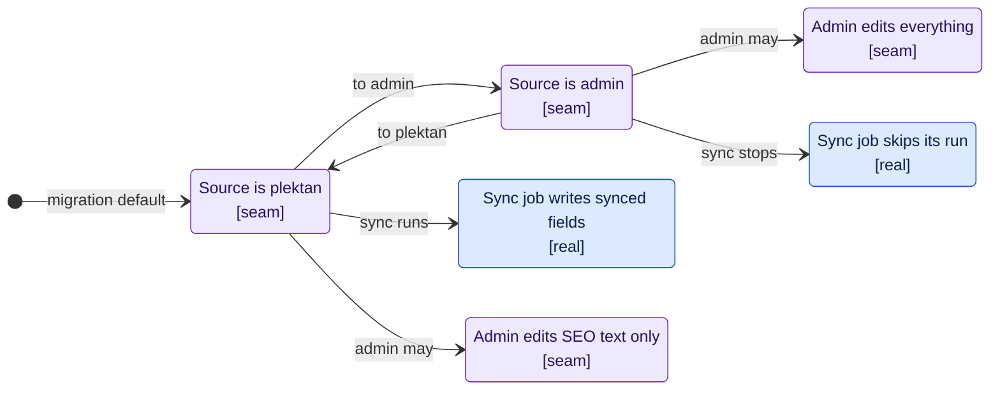

| Block | Data | What it is | Code |
| --- | --- | --- | --- |
| `plektan` | seam | Plektan owns the catalog: the sync writes listings, and the admin may only edit SEO text and publish or hide listings of its own. | `settings.properties_source`, `src/lib/db/settings.ts` |
| `admin` | seam | The admin owns the catalog: every listing can be edited, photographed, published and created by hand, and the sync stops. | `settings.properties_source`, `src/features/admin/settings/actions.ts` |
| `syncwrites` | real | The sync job adds, updates and hides Plektan listings with the service role, and overwrites hand edits on its next run. | `src/lib/sync/run-sync.ts` |
| `adminlimited` | seam | On Plektan listings only seo_title and seo_description can be edited; photos, field edits and creating listings are off. | `src/lib/db/property-permissions.ts`, `src/features/admin/properties/actions.ts` |
| `adminfull` | seam | Every field, photo, publish and hide action is open on every listing, including those that came from Plektan, and new ones can be created. | `src/lib/db/property-permissions.ts`, `src/features/admin/properties/actions.ts` |
| `syncoff` | real | The sync reads the setting first and logs a skip, so nothing is fetched from Plektan and no property row is written. | `src/lib/sync/run-sync.ts` |

## 11. AI assistant turn

One visitor message to the property assistant, then the confirmed request card. The model sits behind one `Llm` interface: with `LLM_API_KEY` it is the OpenAI chat API, without a key it is the scripted assistant that costs nothing, and the turn code is the same on both. Every limit is checked before the model is called and before anything is stored: message length, requests per visitor address, messages per chat and the monthly spend cap. The visitor's message is saved before the model runs, so it survives a model failure. The model can only search the published catalog through the facade and propose a request card; it never creates a lead. Only the visitor's confirmation creates an `ai` lead, and from there it follows [diagram 8](#8-lead-delivery).

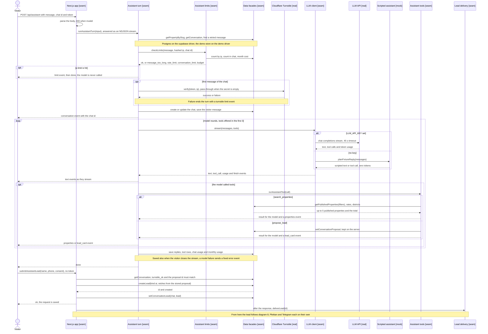

| Block | Data | What it is | Code |
| --- | --- | --- | --- |
| `visitor` | — | A person browsing the catalog, using the favourites, the lead forms and the AI assistant. | `src/app/(site)` |
| `app` | seam | The one Next.js app on Cloudflare Workers that serves the site, the admin and the API, and picks each backend by env. | `src/app/api/assistant/route.ts`, `src/features/assistant/actions.ts` |
| `turn` | seam | Runs one visitor message: loads the chat, calls the model for up to three tool rounds, streams the reply and saves it with the spend. | `src/features/assistant/run-assistant-turn.ts` |
| `limits` | seam | Checks message length, the visitor's request rate, the chat size and the monthly spend cap before any model call. | `src/features/assistant/assistant-limits.ts`, `ASSISTANT_RATE_LIMIT`, `LLM_MONTHLY_BUDGET_USD` |
| `facade` | seam | The only data entry point for pages and actions: it adds caching and picks the Supabase or the demo driver. | `src/lib/db/assistant.ts`, `DATA_DRIVER` in `src/lib/data-driver.ts` |
| `turnstile` | real | Cloudflare Turnstile checks that a lead form was filled in by a person. | `src/lib/turnstile/verify.ts`, `TURNSTILE_SECRET_KEY` |
| `llm` | seam | One streaming interface for the model: the OpenAI API with a key, the scripted assistant without one, chosen on every call. | `src/lib/llm/index.ts`, `LLM_API_KEY`, `LLM_MODEL` |
| `llmapi` | real | The OpenAI chat API that powers the property assistant. | `src/lib/llm/client.ts`, `LLM_API_KEY`, `LLM_MODEL` |
| `llmfx` | mock | A scripted assistant that answers without any model, used when there is no API key. | `src/lib/llm/fixtures/*` |
| `tools` | seam | The two tools the model may call: one searches the published catalog through the facade, the other stores a request card to confirm. | `src/features/assistant/assistant-tools.ts`, `search-properties-tool.ts`, `propose-lead-tool.ts` |
| `deliver` | seam | Sends a saved lead to Plektan and Telegram, each channel on its own, and writes the result back on the lead. | `src/features/leads/deliver-lead.ts` |

## 12. Admin sign-in and photo upload

The admin has two worlds behind the same code. On the `supabase` driver an admin is a Supabase Auth user whose id is listed in the `admins` table, and photos go to R2. On the `demo` driver one click sets a signed cookie, and uploaded photos stay in memory and are served by a demo route. The route guard, the sign-in form, `getAdminSession()` and the upload route are the same on both; each picks its side by `isDemoMode()`. The upload route checks the caller, the properties mode and the file bytes before anything is stored, and removes the stored objects when the database row fails.

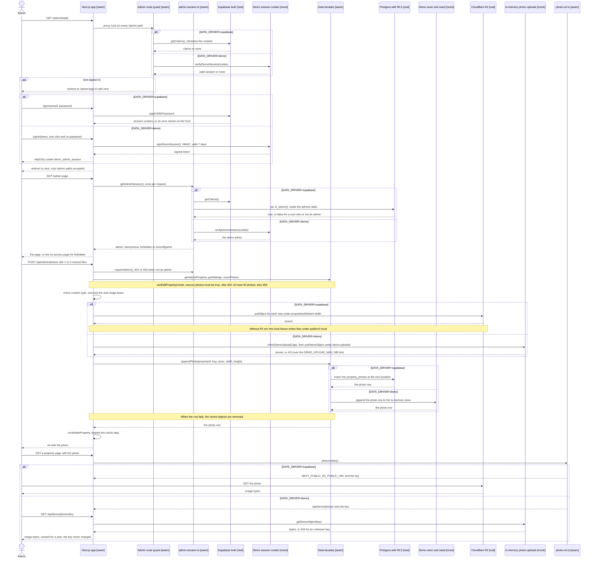

| Block | Data | What it is | Code |
| --- | --- | --- | --- |
| `admin` | — | An agency admin who manages properties, photos, leads, pages, posts and settings. | `src/app/admin` |
| `app` | seam | The one Next.js app on Cloudflare Workers that serves the site, the admin and the API, and picks each backend by env. | `src/features/admin/auth-actions.ts`, `src/app/api/admin/photos/route.ts`, `src/app/api/demo/photos/[...key]/route.ts` |
| `guard` | seam | The proxy that runs on every admin path: it sends anonymous visitors to the sign-in page and keeps admin pages out of search results. | `src/proxy.ts`, `src/lib/supabase/proxy.ts` |
| `adminsession` | seam | Answers who is calling the admin: a Supabase Auth user checked against admins, or the signed demo cookie. | `src/lib/auth/admin-session.ts` |
| `auth` | real | Supabase Auth with email and password; an admin is a user listed in the admins table. | `src/lib/supabase/{server,admin}.ts` |
| `session` | mock | A signed httpOnly cookie behind the one-click demo sign-in, with no account or network call. | `src/lib/demo/session.ts`, `DEMO_SESSION_SECRET` |
| `facade` | seam | The only data entry point for pages and actions: it adds caching and picks the Supabase or the demo driver. | `src/lib/db/admin-property-photos.ts`, `src/lib/db/property-permissions.ts`, `DATA_DRIVER` in `src/lib/data-driver.ts` |
| `pg` | real | Supabase Postgres with row-level security: the production store of properties, photos, leads, pages, posts and AI chats. | `src/lib/db/supabase/admin-property-photos.ts`, `supabase/migrations/` |
| `store` | mock | The in-memory store that holds the typed seed for each process, with the same read and write rules that RLS applies in Postgres. | `src/lib/demo/db/admin-property-photos.ts`, `src/lib/demo/store.ts` |
| `r2` | real | Cloudflare R2 holds property, agent and post photos in two or three sizes; the Worker binding or the S3 API writes them. | `src/lib/r2/client.ts`, `R2_*`, `PHOTOS_BUCKET` |
| `photos` | mock | Photos uploaded in the demo admin, kept in memory and served by a demo route; the limit is set by an env variable. | `src/lib/demo/photos.ts`, `DEMO_UPLOAD_MAX_MB` |
| `photourl` | seam | Turns a stored photo key into a URL: R2, an in-memory demo upload, or a local placeholder file. | `src/lib/photos/photo-url.ts`, `NEXT_PUBLIC_R2_PUBLIC_URL` |
